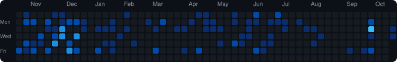

 

---

## 👋 Sobre mim

Sou o **Wanderson José**, de Pernambuco, Brasil. Programo porque isso me permite **criar coisas e transformar a realidade** 😁.

- 🎓 Cursando **Sistemas de Informação** na **UPE – Campus Caruaru**
- 🛠️ Construindo APIs, aplicações web e sistemas orientados a mensageria
- 🧩 Gosto de resolver desafios
- 🎬 Gosto de filmes e séries

---

---

## 🧰 Stack

**Linguagens**

**Front-end**

**Back-end**

**Bancos de dados**

**Ferramentas**

---

---

⛺

 
🔥 Adventista e Desbravador de coração. 
“O amor de Cristo me motiva.”

<!-- Se você achou isto, é porque lê o código. Sempre alerta! ⛺ -->

